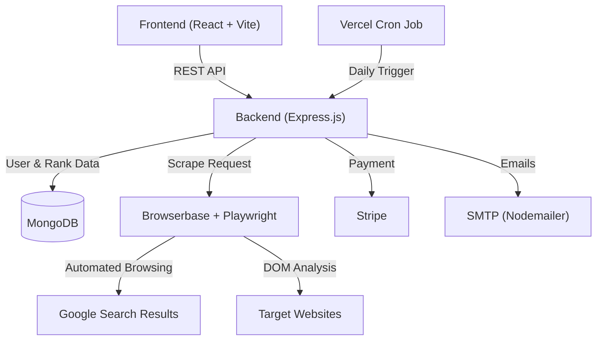

# 🚀 SEO Rank Tracer (RankBoost)

<div align="center">

  
  
  
  
  
  

</div>

<br/>

> A full-stack SEO tool that tracks keyword rankings on Google, performs deep SEO page analysis, and monitors competitors — all powered by headless browser automation.

---

## ✨ Features

- **📊 Keyword Rank Tracking** — Track your website's position for specific keywords across Google search results.
- **🔍 Deep SEO Analysis** — Analyze any URL for meta tags, headings, images, links, performance, SSL, robots.txt, and more.
- **📈 Historical Data & Charts** — View ranking history over time with interactive charts.
- **🏆 Competitor Monitoring** — See which competitors rank for the same keywords and how they compare.
- **🔔 Smart Notifications** — Get notified when your rankings improve or drop.
- **💳 Subscription System** — Free and Pro plans powered by Stripe.
- **🌐 Multi-language Support** — English and Arabic with RTL support.
- **🌙 Dark/Light Mode** — Beautiful glassmorphic UI with theme toggle.
- **📱 PWA Ready** — Installable as a Progressive Web App.
- **⏰ Automated Daily Updates** — Cron jobs refresh rankings automatically.

---

## 🏗️ Architecture

```
seo-rank-tracer/
├── client/          # React + Vite + TypeScript (Frontend)
│   ├── src/
│   │   ├── components/    # Reusable UI components
│   │   ├── pages/         # Route pages (Dashboard, Analyze, etc.)
│   │   ├── context/       # App state (Auth, Theme)
│   │   └── locales/       # i18n translations (en, ar)
│   └── ...
│
├── server/          # Express.js + MongoDB (Backend)
│   ├── controllers/       # Route handlers
│   ├── models/            # Mongoose schemas
│   ├── services/          # Business logic (scraping, analysis)
│   ├── middleware/        # Auth, validation
│   ├── routes/            # API route definitions
│   ├── jobs/              # Cron job scheduler
│   └── utils/             # Email service
│
└── README.md        # This file
```



---

## ⚙️ Prerequisites

- [Node.js](https://nodejs.org/) (v18+)
- [MongoDB](https://www.mongodb.com/) (local or Atlas)
- [Browserbase](https://www.browserbase.com/) account (for scraping)
- [Stripe](https://stripe.com/) account (for subscriptions, optional)
- SMTP credentials (for email verification, optional)

---

## 🚀 Getting Started

### 1. Clone the repository

```bash
git clone https://github.com/redasalem/seo-rank-tracer.git
cd seo-rank-tracer
```

### 2. Setup the Backend

```bash
cd server
npm install
cp .env.example .env
# Edit .env with your MongoDB URI, Browserbase keys, etc.
npm run server    # Starts with nodemon on http://localhost:5000
```

### 3. Setup the Frontend

```bash
cd client
npm install
cp .env.example .env
# Edit .env with your backend URL
npm run dev       # Starts on http://localhost:5173
```

---

## 🔑 Environment Variables

### Server (`server/.env`)

| Variable | Description | Required |
|---|---|:---:|
| `MONGODB_URL` | MongoDB connection string | ✅ |
| `JWT_SECRET` | Secret for JWT access tokens | ✅ |
| `REFRESH_TOKEN_SECRET` | Secret for JWT refresh tokens | ✅ |
| `BROWSERBASE_API_KEY` | Browserbase API key for scraping | ✅ |
| `FRONTEND_URL` | Frontend URL for CORS & email links | ✅ |
| `CRON_SECRET` | Secret for Vercel Cron authentication | ✅ |
| `STRIPE_SECRET_KEY` | Stripe secret key | ❌ |
| `STRIPE_WEBHOOK_SECRET` | Stripe webhook secret | ❌ |
| `SMTP_HOST` / `SMTP_PORT` / `SMTP_USER` / `SMTP_PASS` | SMTP config for emails | ❌ |

### Client (`client/.env`)

| Variable | Description | Required |
|---|---|:---:|
| `VITE_BACKEND_URL` | Backend API base URL | ✅ |

---

## 📚 API Documentation

See [server/API_DOCUMENTATION.md](server/API_DOCUMENTATION.md) for the full API reference.

### Key Endpoints

| Module | Base Path | Description |
|---|---|---|
| Auth | `/api/auth` | Register, Login, Logout, Profile, Password Reset |
| Rank Tracking | `/api/rank` | Add/Get/Delete keywords, Refresh rankings |
| SEO Analysis | `/api/analysis` | Start analysis, Get report |
| Notifications | `/api/notifications` | Get/Mark notifications |
| Subscriptions | `/api/subscription` | Stripe checkout, Webhooks |
| Admin | `/api/admin` | User management (admin only) |
| Cron | `/api/cron` | Automated daily rank updates |

---

## 🧪 Running Tests

### Backend
```bash
cd server
npm test
```

### Frontend
```bash
cd client
npm test
```

---

## ☁️ Deployment

Both the client and server are optimized for **Vercel** deployment:

1. Deploy the `server/` directory as a Node.js project on Vercel.
2. Deploy the `client/` directory as a Vite project on Vercel.
3. Set all required environment variables in each project's Vercel settings.
4. The Cron job is configured in `server/vercel.json` to run daily at 6:00 AM UTC.

---

## 📄 License

This project is licensed under the MIT License — see the [LICENSE.md](client/LICENSE.md) file for details.
