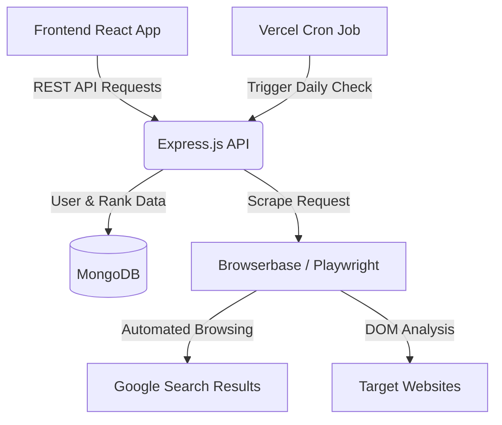

# 🚀 SEO Rank Tracer - Backend Service

<div align="center">
  
  
  
  
  
</div>

<br/>

> A robust, serverless-ready backend service designed to track SEO keyword rankings and perform deep page analysis using headless browser automation.

---

## ✨ Key Features

- **🔐 Secure Authentication:** Complete JWT-based authentication flow with encrypted passwords (bcrypt).
- **🕷️ Headless Scraping:** Utilizes `Playwright` and `BrowserbaseHQ` to reliably scrape search engine results and bypass basic bot detections.
- **🔄 Automated Tracking:** Built-in support for Vercel Cron Jobs to automatically refresh keyword rankings daily.
- **🛡️ API Security:** Configured with strict CORS policies and robust Rate Limiting to prevent abuse.
- **📊 Deep Analysis Engine:** Analyzes page meta tags, heading structures, image alt texts, and performance metrics.

---

## 🏗️ System Architecture



---

## ⚙️ Environment Variables

Create a `.env` file in the root directory. Here are all the required variables:

```env
# Application Port (Local)
PORT="5000"

# Database Connection
MONGODB_URL="mongodb://127.0.0.1:27017/seo"

# Security
JWT_SECRET="your_jwt_secret_here"
CRON_SECRET="your_cron_secret_here"

# Scraper (Browserbase)
BROWSERBASE_API_KEY="your_browserbase_api_key_here"
BROWSERBASE_PROJECT_ID="your_browserbase_project_id_here"

# Security (CORS)
FRONTEND_URL="https://seo-rank-tracer-frontend.vercel.app"
```

> [!WARNING]
> When deploying to Vercel, ensure you add the `CRON_SECRET` and `FRONTEND_URL` in your Vercel Project Settings, otherwise background updates and frontend connections will fail.

---

## 📚 API Documentation

### 🔒 Authentication (Header)
All protected routes require a Bearer token in the request header:
```http
Authorization: Bearer <your_jwt_token_here>
```

### 🧑‍💻 1. Auth API (`/api/auth`)

| Method | Endpoint | Description | Auth Required |
| :--- | :--- | :--- | :---: |
| `POST` | `/register` | Register a new user | ❌ |
| `POST` | `/login` | Authenticate user & get token | ❌ |
| `POST` | `/logout` | Logout user | ❌ |
| `GET`  | `/getCurrentUser` | Get logged-in user details | ✅ |

**Example Payload (`/register` & `/login`):**
```json
{
  "email": "user@example.com",
  "password": "strongpassword123"
}
```

### 📈 2. Rank Tracking API (`/api/rank`)

| Method | Endpoint | Description | Auth Required |
| :--- | :--- | :--- | :---: |
| `POST` | `/add` | Add a new keyword & fetch initial rank | ✅ |
| `GET`  | `/` | Get all tracked keywords | ✅ |
| `GET`  | `/:id` | Get keyword history & competitors | ✅ |
| `POST` | `/:id/refresh` | Force manual refresh of rank | ✅ |
| `PUT`  | `/:id/toggle` | Enable/Disable daily background tracking | ✅ |
| `DELETE`| `/:id` | Delete keyword tracking | ✅ |

**Example Payload (`/add`):**
```json
{
  "keyword": "best smartphones 2024",
  "url": "https://example.com/best-smartphones",
  "country": "US" 
}
```

### 🔍 3. SEO Analysis API (`/api/analysis`)

| Method | Endpoint | Description | Auth Required |
| :--- | :--- | :--- | :---: |
| `POST` | `/start` | Start deep SEO analysis via headless browser | ✅ |
| `GET`  | `/:id` | Get detailed SEO analysis report | ✅ |

**Example Payload (`/start`):**
```json
{
  "url": "https://example.com"
}
```

### ⏰ 4. Automated Cron Jobs (`/api/cron`)

| Method | Endpoint | Description | Auth Required |
| :--- | :--- | :--- | :---: |
| `GET` | `/daily` | Updates all active keywords. Triggered exclusively by Vercel Cron. | ✅ (`CRON_SECRET`) |

---

## 🚀 Getting Started Locally

1. **Install dependencies:**
   ```bash
   npm install
   ```

2. **Setup your environment:**
   Copy `.env.example` to `.env` and fill in your MongoDB URI and Browserbase keys.

3. **Start the development server:**
   ```bash
   npm run server
   ```
   *The server will start on `http://localhost:5000` with nodemon watching for changes.*

---

## ☁️ Deployment

This backend is highly optimized for **Serverless Deployment** on Vercel:
- **Rate Limiting:** is configured with `trust proxy` to work perfectly behind Vercel's edge network.
- **Background Jobs:** `node-cron` is automatically disabled in production (`VERCEL=1`), gracefully handing over scheduling to Vercel's native Cron infrastructure defined in `vercel.json`.
