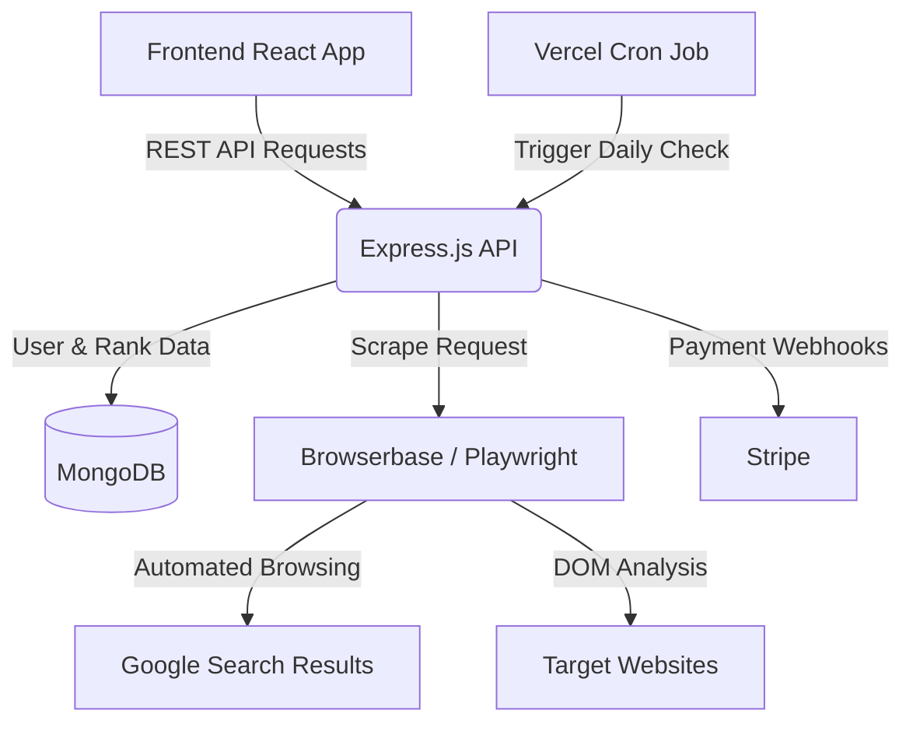

# 🚀 SEO Rank Tracer - Backend Service

<div align="center">
  
  
  
  
  
</div>

<br/>

<div align="center">
  <a href="https://seo-rank-tracer-client.vercel.app" target="_blank"><strong>🌐 Live Frontend Demo</strong></a>
  <span> &nbsp;|&nbsp; </span>
  <a href="https://seo-rank-tracer-server.vercel.app" target="_blank"><strong>⚙️ Live Backend API</strong></a>
</div>

<br/>

> A robust, serverless-ready backend service designed to track SEO keyword rankings and perform deep page analysis using headless browser automation.

---

## ✨ Key Features

- **🔐 Secure Authentication:** Complete JWT-based authentication flow with encrypted passwords (bcrypt) and HttpOnly refresh tokens.
- **🕷️ Headless Scraping:** Utilizes `Playwright` and `BrowserbaseHQ` to reliably scrape search engine results and bypass basic bot detections.
- **🔄 Automated Tracking:** Built-in support for Vercel Cron Jobs to automatically refresh keyword rankings daily.
- **🛡️ API Security:** Configured with strict CORS policies and robust Rate Limiting to prevent abuse.
- **📊 Deep Analysis Engine:** Analyzes page meta tags, heading structures, image alt texts, and performance metrics.
- **🔔 Notification System:** Real-time in-app notifications for rank updates and system events.
- **💳 Subscriptions:** Stripe integration for Pro/Premium limits management.

---

## 🏗️ System Architecture



---

## ⚙️ Environment Variables

Create a `.env` file in the root directory. Here are all the required variables:

```env
# Application Port (Local)
PORT="5000"

# Database Connection
MONGODB_URL="mongodb://127.0.0.1:27017/seo"

# Security
JWT_SECRET="your_jwt_secret_here"
REFRESH_TOKEN_SECRET="your_refresh_secret_here"
CRON_SECRET="your_cron_secret_here"

# Scraper (Browserbase)
BROWSERBASE_API_KEY="your_browserbase_api_key_here"
BROWSERBASE_PROJECT_ID="your_browserbase_project_id_here"

# Stripe 
STRIPE_SECRET_KEY="sk_test_..."
STRIPE_WEBHOOK_SECRET="whsec_..."

# Security (CORS)
FRONTEND_URL="https://seo-rank-tracer-client.vercel.app"
```

> [!WARNING]
> When deploying to Vercel, ensure you add the `CRON_SECRET` and `FRONTEND_URL` in your Vercel Project Settings, otherwise background updates and frontend connections will fail.

---

## 📚 API Documentation Snapshot

*For a full detailed guide, please refer to `API_DOCUMENTATION.md`.*

| Module | Endpoints Examples | Description |
| :--- | :--- | :--- |
| **Auth** | `/api/auth/register`, `/api/auth/login`, `/api/auth/refresh` | Full JWT authentication flow with Password recovery |
| **Rank** | `/api/rank/add`, `/api/rank/stats`, `/api/rank/:id` | Add and track SEO keywords and fetch competitors |
| **Analysis** | `/api/analysis/start`, `/api/analysis` | Trigger deep SEO analysis scans |
| **Notifications** | `/api/notifications`, `/api/notifications/read-all` | Fetch and manage user notifications |
| **Subscription** | `/api/subscription/create-checkout-session` | Stripe payment gateway and customer portal |
| **Admin** | `/api/admin/stats`, `/api/admin/users` | Admin panel metrics and user management |
| **Cron** | `/api/cron/daily` | Vercel cron background updates |

---

## 🚀 Getting Started Locally

1. **Install dependencies:**
   ```bash
   npm install
   ```

2. **Setup your environment:**
   Copy `.env.example` to `.env` and fill in your MongoDB URI and API keys.

3. **Start the development server:**
   ```bash
   npm run server
   ```
   *The server will start on `http://localhost:5000` with nodemon watching for changes.*

4. **Run Tests:**
   ```bash
   npm test
   ```

---

## ☁️ Deployment

This backend is highly optimized for **Serverless Deployment** on Vercel:
- **Rate Limiting:** is configured with `trust proxy` to work perfectly behind Vercel's edge network.
- **Background Jobs:** `node-cron` is automatically disabled in production (`VERCEL=1`), gracefully handing over scheduling to Vercel's native Cron infrastructure defined in `vercel.json`.
